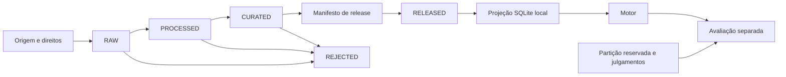

# Arquitetura da MKB

**Decisão aprovada.** O material versionado da MKB é a fonte para reconstruir o banco local do motor. **Proposta de compatibilidade.** O manifesto da MKB enumera as versões do motor testadas. O consumidor confere a própria versão e a do esquema ao abrir a base. A equipe pode corrigir dados e reavaliar direitos em uma edição da MKB com numeração própria. O protocolo de compatibilidade está em [Versionamento](VERSIONING.md).

## Fronteiras de responsabilidade

| Camada lógica | Entradas e resultado | Autoridade e falha observável |
|---|---|---|
| Aquisição | Evidência de origem e direitos, bytes originais se a guarda for permitida, resumo SHA-256 | O agente de coleta declara o alcance permitido. Um identificador de catálogo pode existir antes da aquisição. |
| Processamento | Artefato identificado, parâmetros e versão da transformação → itens com ligação ao original | O agente de dados relata descartes, ambiguidades e falhas. Nova execução usa o mesmo original. |
| Curadoria | Itens processados, fontes e rubrica → revisão aprovada ou rejeição motivada | O revisor valida o significado do registro, o idioma e seu destino de uso. |
| Edição da release | Revisões elegíveis → seleção imutável, fechamento de referências, compatibilidade e atribuições | O mantenedor responde pela composição, pelo escopo de distribuição e pela retirada. |
| Projeção operacional | Manifesto e fontes autorizadas → SQLite, índices e relatório de construção | O construtor local do motor usa o perfil descrito pela MKB e falha se faltar um insumo, uma permissão exigida ou uma referência. |
| Consumo | Artefato compatível em modo de leitura → candidatos, referências e versões | O motor decide o uso segundo a capacidade instalada e registra a trilha da decisão. |

O esquema descreve o caminho de publicação. Uma revogação posterior atua sobre a elegibilidade da release e a distribuição dos artefatos. Uma edição retirada por direitos também deve ser excluída das opções de retorno à versão anterior. Retratações conservam identificadores e motivo no histórico permitido. O tratamento dos originais e das cópias segue a decisão de direitos. Consulte o [pipeline de dados](DATA_PIPELINE.md) e a [governança](DATA_GOVERNANCE.md).

## Organização lógica e física proposta

Os diretórios previstos em `datasets/` correspondem a estágios de trabalho. As coleções em `literary/`, `dictionaries/`, `dialogue/`, `narrative/` e `psychology/` organizam os assuntos. `context/`, `reasoning/` e `learning/` comportam esquemas e dados específicos. Uma coleção física pode abrigar mais de um domínio identificado no envelope. O registro canônico é endereçado por identidade e revisão. Outras coleções apontam para ele, evitando manter cópias concorrentes do mesmo registro. A ocupação dessas pastas depende de material autorizado em fases posteriores.

`schemas/` deverá guardar contratos versionados. `manifests/` liga lotes, processos e revisões. `licenses/` poderá guardar evidências cuja retenção esteja permitida. `releases/` descreverá o que foi efetivamente distribuído. `benchmarks/` terá acesso e manifesto independentes, para que exemplos de avaliação não entrem no índice de recuperação. O repositório Git pode conter referências e hashes para arquivos externos grandes ou de acesso restrito. Um hash identifica bytes e não concede autorização.

## Contrato entre os repositórios

O motor pede uma release específica, confere `knowledge_version`, `schema_version`, `engine_compatibility` (lista fechada de versões do motor efetivamente testadas) e os domínios disponíveis. Na proposta, o manifesto fixa uma única revisão de cada registro operacional, inclui os hashes dos insumos necessários e informa versões de ferramentas e de normalização. Ao abrir uma base, o motor confere se ela corresponde à edição selecionada, se está compatível e se continua elegível. Instalação interrompida deve preservar o banco válido anterior. Consulte os [metadados](METADATA_SPECIFICATION.md) e o [dicionário](DATA_DICTIONARY.md).

## Reconstrução e promoção propostas

1. Resolver os insumos pela seleção exata do manifesto. Conferir hashes e direito aplicável ao destino. Se os originais tiverem acesso limitado, o manifesto distingue reprodução por um curador autorizado de reprodução pelo consumidor a partir dos insumos distribuídos.
2. Validar esquema, referências e unicidade. Ordenar por identidade estável e usar ordenação determinística dos membros. Fixar a codificação, a configuração do tokenizador e as versões de construção.
3. Criar um arquivo SQLite temporário em uma transação. Ativar a verificação de chaves estrangeiras na conexão, projetar os registros elegíveis e construir os índices necessários ao perfil. Um domínio opcional pode ser omitido quando nenhuma referência operacional depende dele. [Chaves estrangeiras no SQLite](https://sqlite.org/foreignkeys.html)
4. Conferir integridade relacional, contagens por domínio e hash lógico de uma exportação canônica em ordem definida, incluindo vínculos e configurações. Para o perfil Genesis, conferir também resultados ordenados de consultas de auditoria. FTS5 oferece busca de texto completo e uma função BM25. A escolha de tokenizador e sua disponibilidade no ambiente local precisam ser registradas. [SQLite FTS5](https://www.sqlite.org/fts5.html)
5. Comparar duas construções limpas. Equivalência lógica exige as mesmas linhas, vínculos, configurações e resultados de auditoria. Uma promessa adicional de igualdade byte a byte exigirá controlar também versão da biblioteca, opções de compilação e detalhes de layout. Promover o artefato validado por troca atômica no mesmo sistema de arquivos.

## Restrições e decisões abertas

O computador de referência dispõe de 16 GB de RAM, SSD de 512 GB e CPU i5-1235U, sob Ubuntu e sem GPU dedicada. Processar por lote e medir pico de memória, espaço temporário, tempo de reconstrução e tamanho do índice antes de ampliar a seleção. A primeira projeção pode carregar apenas Talksets de DLG e seus metadados de suporte. A [arquitetura do motor](../../mimesis/docs/ARCHITECTURE.md) descreve o consumidor e seu limite de autoridade. Reavaliar armazenamento colunar e índices semânticos após medir volumes reais. Tamanho de lote, limites de distribuição e metas numéricas de desempenho ficam pendentes dessas medições.
