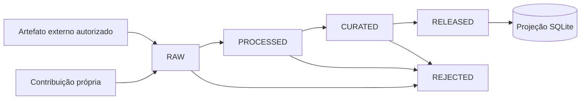

# Ciclo de vida e construção do banco local

A aquisição externa e a autoria própria correm em paralelo. Ambas exigem evidência de origem, direitos para a operação pretendida e revisão. A coleta começa somente em tarefa de dados autorizada. Na trilha autoral, o original é o lote de contribuição com a evidência de autoria. Na externa, é o artefato da edição específica.

| Transição | Responsável e insumo | Verificação para avançar | Evidência de saída |
|---|---|---|---|
| Registro → RAW | Coleta confere autorização de cópia e recebe bytes. | Identificar edição, uso autorizado e SHA-256 do original. Se nem a cópia for permitida, registrar apenas parecer bibliográfico autorizado. | Recibo de aquisição, objeto imutável e cadastro de origem. |
| RAW → PROCESSED | Engenharia extrai, segmenta e gera representação de busca separada. | Reexecutar transformação com versão e configuração fixas, conferir contagens e localizadores. | Registros tipados e mapa até os bytes de origem. |
| PROCESSED → CURATED | Curadoria examina idioma, duplicatas, rótulos, qualidade e direitos. | Resolver desacordos, vínculos e campos obrigatórios. Agrupar famílias para avaliação antes de dividir dados. | Revisão identificada, parecer e grupo atribuído. |
| CURATED → RELEASED | Responsável pela edição seleciona revisões para um uso definido. | Verificar autorização para distribuir cada componente, exclusões, hashes, remissões, compatibilidade e separação do benchmark. | Manifesto imutável e lista dos artefatos liberados. |
| Qualquer etapa pré-liberação → REJECTED | Revisor guarda decisão e aponta evidência. | Classificar motivo, etapa, data, agente e possibilidade de correção. | Recibo rastreável. Material restrito segue os prazos e permissões aplicáveis. |

**Reprocessamento.** A chave de trabalho reúne identidade e hash das entradas, atividade, versão da ferramenta e digest da configuração. Repetir a mesma chave verifica ou reutiliza o resultado. Conteúdo divergente interrompe o lote. Uma correção cria nova revisão ligada ao caso rejeitado e reingressa na etapa adequada. Saídas parciais ficam em área temporária. A promoção ocorre após conferência de todas as contagens. Retirar algo já liberado segue o procedimento de retirada e edição substituta. [Versionamento](VERSIONING.md)

### Reconstrução verificável

1. Selecionar manifesto e verificar sua origem, versões, direitos e hashes de todos os insumos. Um componente ausente ou incompatível interrompe a construção.
2. Criar banco temporário vazio com configurações e versões registradas. Inserir revisões selecionadas em ordem estável de ID. Materializar tabelas de pesquisa e índices usando perfil de normalização versionado. Os dados e julgamentos reservados à avaliação ficam fora do índice.
3. Verificar integridade do SQLite, chaves, unicidade, contagens por domínio e por tabela. Para FTS5, verificar correspondência entre linhas do índice e prompts ativos. Reproduzir consultas sentinela com ordem e desempate fixos.
4. Calcular digest lógico por tabela sobre serialização canônica dos registros ordenados, guardando a descrição da serialização. Guardar também SHA-256 do arquivo construído e versões de SQLite, tokenizador, projeto e compilador. Igualdade lógica é o requisito reprodutível. Igualdade física exige o mesmo ambiente e procedimento e deve ser testada separadamente.
5. Promover o arquivo validado por troca atômica no mesmo sistema de arquivos, mantendo a versão anterior enquanto houver leitores. Falha antes da troca deixa a base anterior servindo. Se houver retirada por direitos, bloquear a edição afetada também para retorno.

O repositório de conhecimento governa os insumos e a especificação do esquema. A ferramenta de compilação do banco de execução pertence ao motor. Dados intermediários, análises e importadores pertencem à engenharia da MKB. [Arquitetura do motor](../../mimesis/docs/ARCHITECTURE.md) · [Qualidade](DATA_QUALITY.md)
